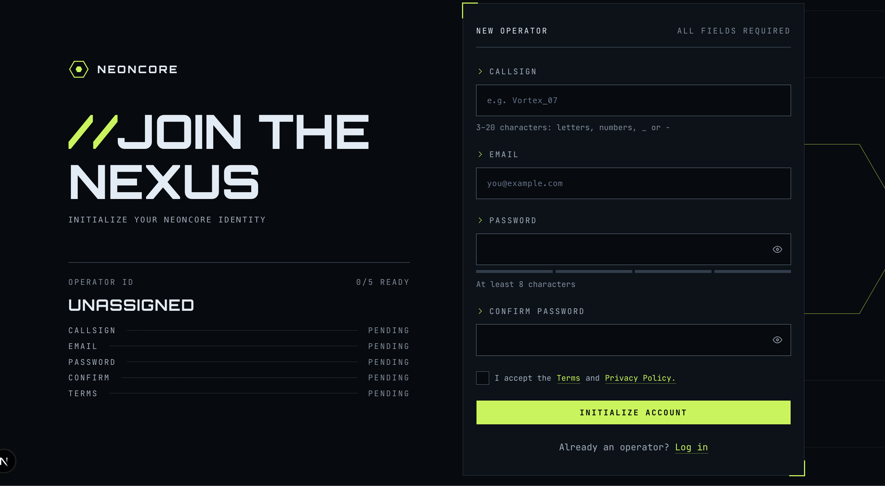

# Frontend Mentor - Gamer sign-up form solution

This is a solution to the [Gamer sign-up form challenge on Frontend Mentor](https://www.frontendmentor.io/challenges/gamer-sign-up-form). Frontend Mentor challenges help you improve your coding skills by building realistic projects.

## Table of contents

- [Overview](#overview)
  - [The challenge](#the-challenge)
  - [Screenshot](#screenshot)
  - [Links](#links)
- [My process](#my-process)
  - [Built with](#built-with)
  - [What I learned](#what-i-learned)
  - [Continued development](#continued-development)
  - [AI Collaboration](#ai-collaboration)
- [Author](#author)

## Overview

### The challenge

Users should be able to:

- Fill in the form with a callsign, email, password, and password confirmation, and accept the terms
- Receive form validation messages if any field is missed or filled in incorrectly
- Show and hide each password with the eye button
- See a password strength meter update as they type
- See a loading state on the button while the form submits, then a success message
- Complete the form only using their keyboard
- Have inputs, hints, error messages, and the success message announced on their screen reader
- View the optimal layout for the interface depending on their device's screen size
- See hover and focus states for all interactive elements on the page

### Screenshot



### Links

- Solution URL: [https://github.com/AjeaSmith/neon-gamer-signup](https://github.com/AjeaSmith/neon-gamer-signup)
- Live Site URL: [https://neon-gamer-signup.vercel.app/](https://neon-gamer-signup.vercel.app/)

## My process

### Built with

- Semantic HTML5 markup
- CSS custom properties
- Flexbox
- CSS Grid
- Mobile-first workflow
- [Next.js](https://nextjs.org/) - React framework
- [React Hook Form](https://react-hook-form.com/) - react form library for handling validation
- [Tailwindcss](https://tailwindcss.com/) - For styles
- [Shadcn UI](https://ui.shadcn.com/) - For UI components

### What I learned
I learn how to use the Form Provider component for nested components that need access to form methods/data. 

```js
<FormProvider {...form}>
  <FormStatus />
  <SignUpForm />
</FormProvider>
```

### Continued development

I still want to properly learn how to manage typing data with typescript. 

### AI Collaboration
- I used claude code for boilerplate theme setup e.g. (setting up colors, fonts etc ). 
- Also helped with understanding concepts. 
- Debugging

## Author

- Website - [Ajea Smith](https://smith-dev-steel.vercel.app/)
- Frontend Mentor - [@ajeasmith](https://www.frontendmentor.io/profile/ajeasmith)
